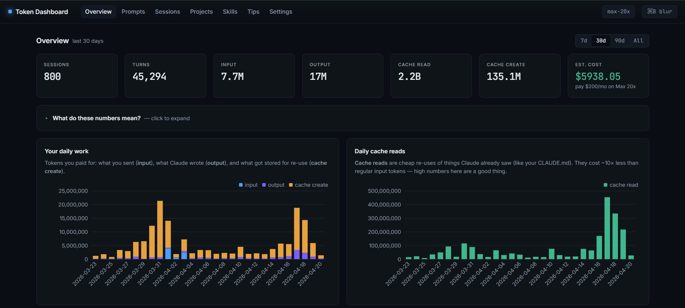
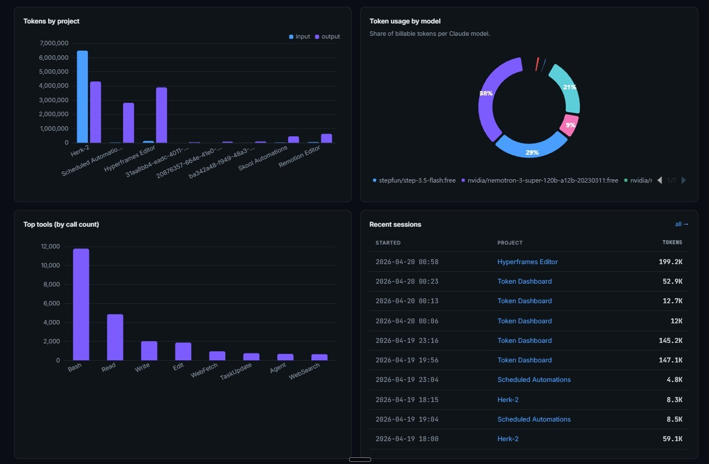

# Token Dashboard

Um dashboard local que lê as transcrições JSONL que o Claude Code grava em `~/.claude/projects/` e as transforma em análise de custo por prompt, mapas de calor de ferramentas/arquivos, atribuição de subagentes, análise de cache, comparação entre projetos e um motor de dicas baseado em regras.

**Tudo roda localmente.** Nenhum dado sai da sua máquina — sem telemetria, sem chamadas de API com seus dados, sem login.





## Para que isto serve

- Ver quais dos seus prompts são caros (surpresa: geralmente envolvem resultados grandes de ferramentas).
- Comparar uso de tokens entre projetos em que você trabalhou.
- Identificar padrões desperdiçadores — o mesmo arquivo lido vinte vezes em uma sessão, uma chamada de ferramenta retornando 80k tokens.
- Entender o que um "cache hit" realmente economiza.
- Se você está no Pro ou Max, confirmar que está tendo retorno do dinheiro em dólares equivalentes à API.

## Pré-requisitos

- **Python 3.8 ou mais novo** — já instalado no macOS e na maioria do Linux. No Windows: `winget install Python.Python.3.12` ou baixe de python.org.
- **Claude Code** — instalado e com pelo menos uma sessão executada. O dashboard lê essas sessões. Se você acabou de instalar o Claude Code e ainda não o usou, rode pelo menos um prompt primeiro.
- **Um navegador web.** Qualquer um moderno.

Sem `pip install`. Sem Node.js. Sem etapa de build.

## Início rápido

```bash
git clone https://github.com/inematds/token-dashboard.git
cd token-dashboard
python3 cli.py dashboard
```

> No Windows, se `python3` não estiver no PATH, substitua `py -3` por `python3` em todos os comandos abaixo.

O comando:
1. Varre `~/.claude/projects/` (a primeira execução pode levar 20–60 segundos na máquina de um usuário pesado).
2. Inicia um servidor local em http://127.0.0.1:8080.
3. Abre seu navegador padrão nessa URL.

Deixe rodando; ele re-varre a cada 30 segundos e envia atualizações ao vivo. Pare com `Ctrl+C`.

## De onde vêm os dados

O Claude Code grava um arquivo JSONL por sessão aqui:

| SO | Caminho |
|---|---|
| macOS / Linux | `~/.claude/projects/<project-slug>/<session-id>.jsonl` |
| Windows | `C:\Users\<you>\.claude\projects\<project-slug>\<session-id>.jsonl` |

O dashboard nunca modifica esses arquivos — apenas os lê e mantém um cache SQLite local em `~/.claude/token-dashboard.db`.

Para apontar para outro local:

```bash
python3 cli.py dashboard --projects-dir /path/to/projects --db /path/to/cache.db
```

### Variáveis de ambiente

| Var | Padrão | Propósito |
|---|---|---|
| `PORT` | `8080` | Porta em que o servidor web local escuta |
| `HOST` | `127.0.0.1` | Endereço de bind. Mantenha o padrão. Definir `0.0.0.0` expõe todo o seu histórico de prompts a qualquer um na sua rede local — não faça isso em nenhuma rede que você não controle totalmente (nada de Wi-Fi de cafeteria, nada de coworking). |
| `CLAUDE_PROJECTS_DIR` | `~/.claude/projects` | Onde varrer os arquivos JSONL de sessão |
| `TOKEN_DASHBOARD_DB` | `~/.claude/token-dashboard.db` | Local do cache SQLite |

Os preços ficam em [`pricing.json`](pricing.json). Edite-o diretamente se os preços dos modelos mudarem ou para adicionar um novo plano.

## Referência da CLI

```bash
python3 cli.py scan          # popula / atualiza o DB local e sai
python3 cli.py today         # totais de hoje (terminal)
python3 cli.py stats         # totais de todo o período (terminal)
python3 cli.py tips          # sugestões ativas (terminal)
python3 cli.py dashboard     # scan + serve a UI em http://localhost:8080

# flags do dashboard
python3 cli.py dashboard --no-open   # não abre o navegador automaticamente
python3 cli.py dashboard --no-scan   # pula o scan inicial (usa só o DB em cache)
```

Trocar a porta: `PORT=9000 python3 cli.py dashboard`.

## As 7 abas

O dashboard é uma página única com uma barra de abas no topo usando hash-router. Cada aba é alimentada por sua própria API JSON em `/api/`:

- **Overview** — tokens de input/output/cache de todo o período, sessões, turnos, custo estimado no plano escolhido, gráficos diários de trabalho e leitura de cache, tokens por projeto, participação de tokens por modelo, top de ferramentas por contagem de chamadas e sessões recentes. Esta é a aba inicial.
- **Prompts** — seus prompts de usuário mais caros, ranqueados por tokens. Clique em qualquer linha para ver a resposta do assistente, as chamadas de ferramenta feitas e o tamanho de cada resultado de ferramenta.
- **Sessions** — visão turno a turno de qualquer sessão, com tokens e chamadas de ferramenta por turno.
- **Projects** — comparação por projeto: tokens, contagem de sessões e quais arquivos foram mais tocados.
- **Skills** — quais skills você invoca com mais frequência e (onde dá pra medir) seu custo em tokens. Veja [limitações](docs/KNOWN_LIMITATIONS.md#skills-token-counts-are-partial).
- **Tips** — sugestões baseadas em regras para reduzir uso de tokens (leituras repetidas de arquivos, resultados de ferramentas grandes demais, taxa baixa de cache hit, etc.).
- **Settings** — alterna o pricing entre API / Pro / Max / Max-20x para que os valores de custo em todo o resto reflitam seu plano real.

A aba Overview também tem um painel embutido "What do these numbers mean?" que explica tokens de input/output/cache em linguagem simples.

## Solução de problemas

**"Sem dados" ou gráficos vazios.** Rode `python3 cli.py scan` uma vez para popular o DB e recarregue.

**Porta 8080 já em uso.** `PORT=9000 python3 cli.py dashboard`.

**Números parecem errados / travados.** O DB fica em `~/.claude/token-dashboard.db`. Apague e rode `python3 cli.py scan` para reconstruir do zero.

**Rodar o dashboard duas vezes ao mesmo tempo.** Não faça — os dois processos vão brigar pelo DB SQLite. Pare todas as instâncias antes de iniciar uma nova.

## Nota sobre precisão

O Claude Code grava cada resposta do assistente 2–3 vezes em disco enquanto ela faz streaming (a mesma mensagem da API é snapshotada conforme o output cresce). O dashboard deduplica isso por `message.id` para que o total final bata com o que a API realmente cobrou. Se você comparar com outra ferramenta que soma cada linha do JSONL, espere que os números deste dashboard sejam menores — e mais próximos da realidade.

## Privacidade

Nada sai da sua máquina. Sem telemetria. Sem chamadas remotas com seus dados. O navegador busca seu JSON de `127.0.0.1`, e todo JS/CSS/fonte é servido por esse mesmo servidor local — o ECharts está vendorizado em `web/`, e a UI usa fontes do sistema como fallback em vez de buscar de uma CDN de fontes. Se quiser verificar: `grep -r "https://" token_dashboard/ web/` — não vai encontrar nada.

## Stack técnica

Python 3 (só stdlib) para a CLI, scanner e servidor HTTP. SQLite para o cache local. Vanilla JS + ECharts para a UI, sem etapa de build. Tema escuro, router baseado em hash, server-sent events para refresh ao vivo.

Fluxo de dados: `cli.py` → `token_dashboard/scanner.py` → DB SQLite; `token_dashboard/server.py` expõe rotas JSON `/api/*` e serve `web/`.

## Leitura adicional

- [`CLAUDE.md`](CLAUDE.md) — convenções e visão geral da arquitetura (também é lido automaticamente pelo Claude Code)
- [`CONTRIBUTING.md`](CONTRIBUTING.md) — como desenvolver e testar
- [`docs/KNOWN_LIMITATIONS.md`](docs/KNOWN_LIMITATIONS.md) — pontas soltas
- [`docs/inspiration.md`](docs/inspiration.md) — trabalho anterior e como este projeto diverge
- [`docs/claude-mem-tuning.md`](docs/claude-mem-tuning.md) — caso real de uso do dashboard para auditar e ajustar o plugin claude-mem

## Contribuindo

Veja [`CONTRIBUTING.md`](CONTRIBUTING.md). Versão curta: faça fork, rode `python3 -m unittest discover tests` antes de abrir um PR, mantenha só stdlib.

## Licença

[MIT](LICENSE).

---

Projeto adaptado da comunidade INEMA TDS - Marca Arckhe